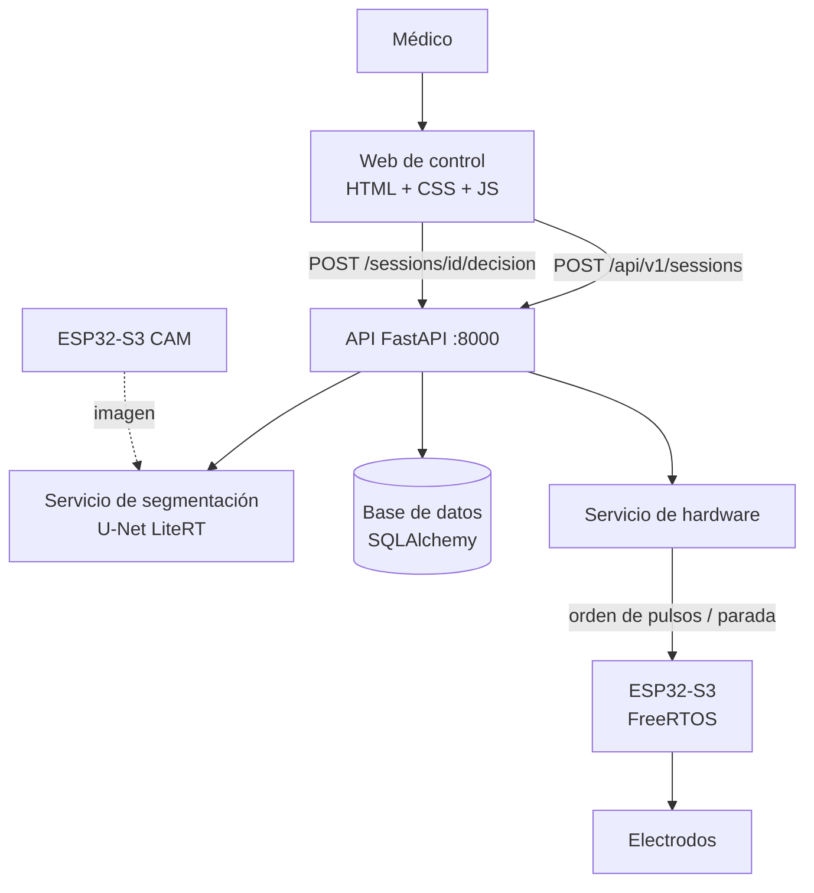
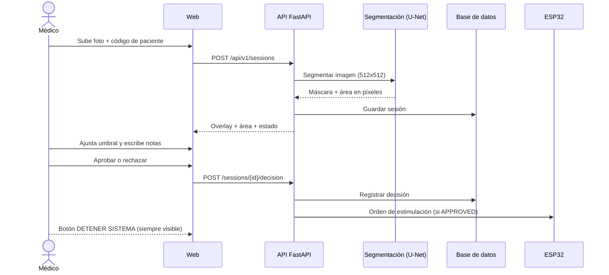
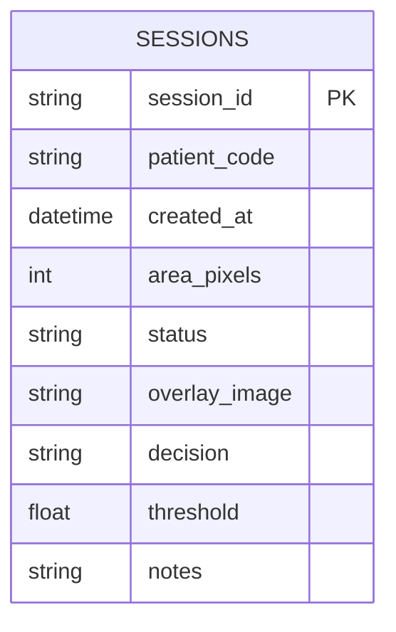

# Nova Luz: Sistema Embebido Inteligente para Heridas Crónicas

Proyecto del curso **Sistemas Embebidos 2026-2** (Universidad Central). Equipo **Nova Luz**: Alejandro Urrego, Johan González y Jhonny Jiménez.

Sistema que segmenta úlceras de pie diabético con una red **U-Net**, permite al médico validar el resultado desde una **aplicación web** y, con su aprobación, envía la orden de estimulación eléctrica a un **ESP32** con FreeRTOS. La web es el centro de control: desde ahí se sube la foto, se valida la IA y se toma la decisión clínica final (aprobar, rechazar o activar la parada de emergencia).

| Capa | Dónde se aplica |
| --- | --- |
| Visión e inferencia | U-Net exportada a LiteRT/TFLite, ejecutada en Raspberry Pi |
| Control en tiempo real | ESP32-S3 con FreeRTOS, genera los pulsos de estimulación |
| Aplicación web | FastAPI + frontend HTML/CSS/JS como panel de decisión clínica |

## Contenido

1. [Arquitectura utilizada](#1-arquitectura-utilizada)
2. [Diagrama de componentes](#2-diagrama-de-componentes)
3. [Diagrama de secuencia](#3-diagrama-de-secuencia)
4. [Modelo de IA (U-Net)](#4-modelo-de-ia-u-net)
5. [Aplicación web](#5-aplicación-web)
6. [Modelo de datos]
7. [Instrucciones para ejecutar el proyecto](#6-instrucciones-para-ejecutar-el-proyecto)
8. [Metodología de trabajo](#7-metodología-de-trabajo)
9. [Historial de tareas](#8-historial-de-tareas)
10. [Tecnologías](#9-tecnologías)
11. [Estado actual y limitaciones](#10-estado-actual-y-limitaciones)
12. [Trabajo futuro](#11-trabajo-futuro)

---

## 1. Arquitectura utilizada

El backend sigue el **patrón Repository con interfaces**, de modo que la IA, la base de datos y el hardware se pueden cambiar sin tocar la API ni el frontend.

- **api**: rutas FastAPI y esquemas Pydantic.
- **services**: interfaces (`interfaces.py`) e implementaciones (simuladas o reales).
- **frontend**: plantilla HTML, estilos y lógica en JavaScript.

Estructura principal del repositorio:

```
.
├── app/
│   ├── main.py               # API FastAPI
│   ├── models/schemas.py     # Esquemas Pydantic
│   ├── services/interfaces.py# Contratos (IA, repositorio, hardware)
│   ├── templates/index.html  # Panel de control
│   └── static/               # css/, js/, img/
├── data/                     # Auditoría y partición del dataset
├── docs/adr/                 # Decisiones de arquitectura
├── reports/                  # Informes de rendimiento
├── tests/test_api.py
└── requirements.txt
```

Reglas de diseño que se respetan:

- La web nunca habla directo con el hardware: siempre pasa por la API.
- Los servicios dependen de interfaces, no de implementaciones concretas.
- Los pacientes se identifican con un código anónimo (ADR-002).
- El umbral de binarización tiene límites de seguridad: 0.30 a 0.70.

## 2. Diagrama de componentes



## 3. Diagrama de secuencia



## 4. Modelo de IA (U-Net)

- Dataset: **Foot Ulcer Segmentation Challenge** (810 pares de entrenamiento, 200 de validación, 200 imágenes de prueba sin máscaras), todo a 512×512.
- Se aislaron las máscaras vacías, se binarizaron las máscaras con valor `> 0` y se definió una partición de validación limpia de 187 imágenes.
- Métricas unificadas: **Dice** e **IoU**, calculadas con la misma función sobre la misma partición.
- Dice por imagen en validación limpia: 0.6775 (corrida 1) y 0.7348 (corrida 2).
- Exportación a **LiteRT/TFLite (float32)** y verificación numérica frente a Keras.
- Validación en Raspberry Pi: 100 % de equivalencia en 10 imágenes de prueba respecto a Windows.

## 5. Aplicación web

Panel de decisión clínica en tres pasos:

1. **Captura**: código de paciente e imagen de la lesión.
2. **Validación**: overlay de la segmentación, área estimada y estado de la sesión.
3. **Decisión**: umbral de binarización, notas clínicas, aprobar o rechazar.

Características de la interfaz:

- Pantalla de carga con el logo y logo fijo en el encabezado.
- **Encabezado fijo con el botón DETENER SISTEMA siempre visible**, incluso con scroll y en celular.
- Diseño responsivo y paleta tomada del logo (azul marino, azul cielo y naranja).
- Indicadores de estado del sistema y del ESP32.

## 6. Modelo de datos

La API persiste las sesiones clínicas con SQLAlchemy. Cada sesión guarda el paciente (código anónimo), el resultado de la segmentación y la decisión del médico.



| Campo | Descripción |
| --- | --- |
| `session_id` | Identificador único de la sesión |
| `patient_code` | Código anónimo del paciente (ADR-002), sin nombres |
| `area_pixels` | Área segmentada en píxeles |
| `status` | Estado de la sesión (por ejemplo `PENDING`) |
| `overlay_image` | Ruta de la imagen con la segmentación superpuesta |
| `decision` | `APPROVED` o `REJECTED` (nulo hasta que el médico decide) |
| `threshold` | Umbral de binarización usado, entre 0.30 y 0.70 |
| `notes` | Notas clínicas del médico |

Esquemas de la API (`app/models/schemas.py`): `SessionCreate` (entrada de la captura), `DecisionCreate` (decisión, umbral y notas) y `SessionResponse` (respuesta con área, estado y overlay).

## 7. Instrucciones para ejecutar el proyecto

Requisitos: Python 3.12 y Git.

```bash
git clone https://github.com/AlejandroUrregoIdarraga29/pie-diabetico-ia.git
cd pie-diabetico-ia
python -m venv pie_diabetico_env
pie_diabetico_env\Scripts\activate      # Windows
pip install -r requirements.txt
uvicorn app.main:app --reload --host 0.0.0.0 --port 8000
```

| Componente | URL |
| --- | --- |
| Panel de control | http://localhost:8000 |
| Documentación de la API (Swagger) | http://localhost:8000/docs |

Para abrirlo desde un celular en la misma red Wi-Fi: `http://IP-DE-TU-PC:8000`.

Pruebas:

```bash
pytest tests/
```

## 8. Metodología de trabajo

Flujo por tarea, una rama por cada una:

1. Tarea en Trello (flujo simple y lineal).
2. Rama Git por tarea (`feature/...`).
3. Desarrollo y pruebas locales.
4. Commit y push de la rama.
5. Pull Request y merge a `main`.
6. Actualizar Trello y pasar a la siguiente tarea.

## 9. Historial de tareas

### Carril A: modelo e IA

| Tarea | Rama | Qué se hizo | Archivos clave |
| --- | --- | --- | --- |
| A1 | `feature/a1-repo-reproducible` | Estructura base, rutas relativas y dependencias fijadas para reproducir el entorno | `requirements.txt`, `README.md`, `.gitignore` |
| A2 | `feature/a2-datos` | Auditoría y limpieza del dataset: máscaras vacías aisladas (incluida la 0233), datos erróneos clasificados y partición de evaluación definida | `clasificar_vacias.py`, scripts de partición en `data/` |
| A3 | `feature/a3-baseline` | Entrenamiento y documentación del baseline U-Net, métricas Dice/IoU unificadas y evaluación automatizada con dos corridas | `train_baseline.py`, `evaluate.py`, `metrics.py` |
| A4 | `feature/a4-visualizacion` | Diagnóstico visual: original, ground truth y predicción, con los mejores y peores casos | `visualize_predictions.py`, `outputs/plots/` |
| A5 | `feature/a5-exportar-tflite` | Exportación a LiteRT/TFLite (float32) y comparación numérica contra Keras | `export_tflite.py`, `model_quantized.tflite` |
| A6 | `feature/a6-raspberry` | Despliegue en Raspberry Pi 3: runtime LiteRT, preprocesamiento ajustado y 100 % de equivalencia en 10 imágenes | `test_raspberry_inference.py`, `reports/a6_performance_report.md` |

### Carril W: aplicación web

| Tarea | Rama | Qué se hizo | Archivos clave |
| --- | --- | --- | --- |
| W0 | `feature/w0-adr-web` | Decisión de arquitectura (ADR-002): reglas de interfaz, anonimización de pacientes e historial clínico | `docs/adr/ADR-002-web-architecture.md` |
| W1 | `feature/w1-fastapi-backend` | API REST modular con patrón Repository e interfaces (mocks) que desacoplan IA, base de datos y hardware | `app/main.py`, `app/services/interfaces.py`, `app/models/schemas.py`, `tests/test_api.py` |
| W2 | `feature/w2-frontend-ui` | Interfaz para previsualizar el overlay, ajustar el umbral y enviar la aprobación o el rechazo | `app/templates/index.html`, `app/static/css/style.css`, `app/static/js/app.js` |
| W3 | `feature/w3-frontend` | Mejoramiento del frontend: identidad visual Nova Luz, pantalla de carga, encabezado fijo con parada de emergencia y diseño responsivo | `index.html`, `style.css`, `static/img/logo.jpeg` |

## 10. Tecnologías

| Área | Herramientas |
| --- | --- |
| Entorno y control de versiones | Python, Git, pip |
| Datos | Pandas, OpenCV, NumPy |
| Modelo | TensorFlow / Keras, Scikit-learn, Matplotlib, PIL |
| Exportación y borde | TensorFlow Lite Converter, FlatBuffers, LiteRT Runtime, XNNPACK, Raspbian |
| Backend | FastAPI, Uvicorn, SQLAlchemy, Pydantic, Pytest |
| Frontend | HTML5, CSS3, JavaScript (Fetch API), Canvas API |
| Documentación | Markdown, Mermaid, ADR |

## 11. Estado actual y limitaciones

- **La segmentación de la web usa un servicio simulado** (`MockSegmentationService`): devuelve un recuadro fijo y un área constante. La U-Net real ya está exportada y validada en Raspberry Pi, pero aún no está inyectada en la API.
- El slider de umbral se envía junto con la decisión; todavía no vuelve a segmentar la imagen.
- El botón de parada de emergencia muestra una alerta; falta conectarlo al backend y al ESP32.
- El área se mide en píxeles de la imagen redimensionada, sin escala real (cm/píxel).

## 12. Trabajo futuro

- Inyectar `LiteRTSegmentationService` en lugar del servicio simulado.
- Endpoint para re-segmentar con el umbral elegido.
- Conectar la orden de decisión y la parada de emergencia al ESP32 (FreeRTOS).
- Indicador visible de "modo simulado" mientras exista el mock.
- Escala de medición real para el área de la lesión.
- Evidencias: capturas y video de la demo con el hardware conectado.
