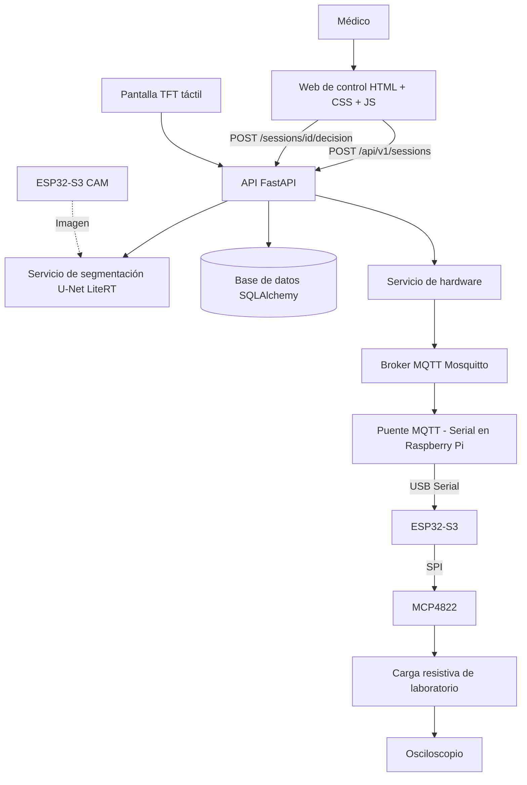
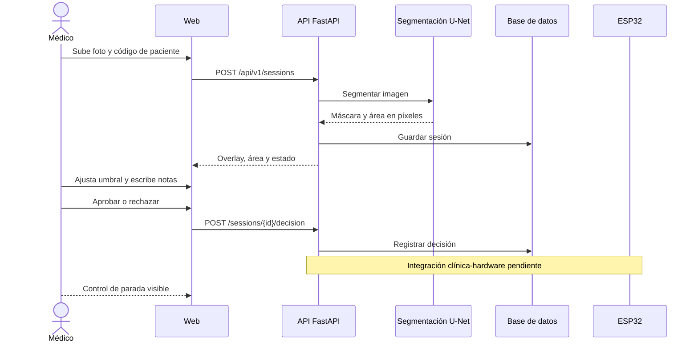
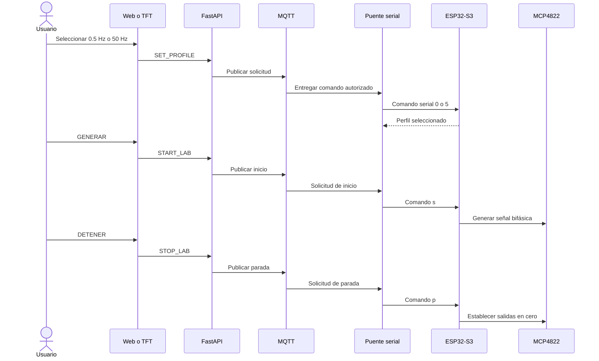
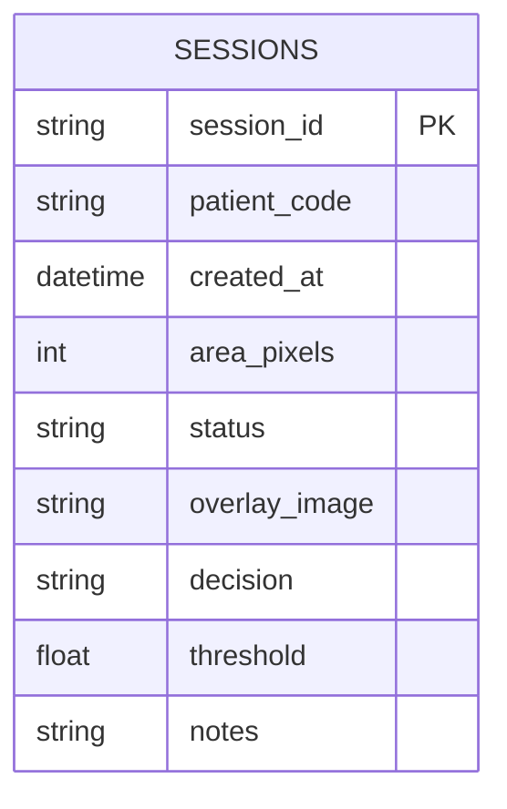

# Nova Luz: Sistema Embebido Inteligente para Heridas Crónicas

Proyecto del curso **Sistemas Embebidos 2026-2** (Universidad Central). Equipo **Nova Luz**: Alejandro Urrego, Johan González y Jhonny Jiménez.

Sistema que segmenta úlceras de pie diabético mediante una red **U-Net**, permite visualizar y validar los resultados desde una **aplicación web** e integra un módulo experimental de generación de pulsos eléctricos bifásicos mediante **ESP32-S3 y MCP4822**.

La web constituye el centro de control del sistema: permite cargar imágenes, visualizar la segmentación, registrar decisiones y supervisar el módulo electrónico. La integración entre la decisión clínica y la generación de pulsos continúa en desarrollo.

El módulo electrónico se ha implementado y evaluado exclusivamente en condiciones de laboratorio mediante una carga resistiva de **2,2 kΩ**, sin aplicación sobre pacientes.

| Capa | Dónde se aplica |
| --- | --- |
| Visión e inferencia | U-Net exportada a LiteRT/TFLite, ejecutada en Raspberry Pi |
| Control embebido | ESP32-S3 programado con Arduino y PlatformIO |
| Generación de señales | MCP4822, con dos perfiles bifásicos de 0,5 Hz y 50 Hz |
| Comunicación | MQTT, USB serial y red local |
| Aplicación web | FastAPI + frontend HTML/CSS/JS |
| Interfaz física | Pantalla TFT táctil conectada a Raspberry Pi |
| Validación experimental | Osciloscopio y carga resistiva de 2,2 kΩ |

## Contenido

1. [Arquitectura utilizada](#1-arquitectura-utilizada)
2. [Diagrama de componentes](#2-diagrama-de-componentes)
3. [Diagrama de secuencia](#3-diagrama-de-secuencia)
4. [Modelo de IA (U-Net)](#4-modelo-de-ia-u-net)
5. [Aplicación web](#5-aplicación-web)
6. [Modelo de datos](#6-modelo-de-datos)
7. [Instrucciones para ejecutar el proyecto](#7-instrucciones-para-ejecutar-el-proyecto)
8. [Metodología de trabajo](#8-metodología-de-trabajo)
9. [Historial de tareas](#9-historial-de-tareas)
10. [Tecnologías](#10-tecnologías)
11. [Estado actual y limitaciones](#11-estado-actual-y-limitaciones)
12. [Trabajo futuro](#12-trabajo-futuro)

---

## 1. Arquitectura utilizada

El backend sigue el **patrón Repository con interfaces**, de modo que la IA, la base de datos y el hardware se pueden cambiar sin tocar la API ni el frontend.

- **api**: rutas FastAPI y esquemas Pydantic.
- **services**: interfaces (`interfaces.py`) e implementaciones simuladas o reales.
- **frontend**: plantilla HTML, estilos y lógica en JavaScript.
- **hardware**: ESP32-S3 y convertidor digital-analógico MCP4822.
- **comunicación**: intermediación entre FastAPI, MQTT y comunicación serial.
- **interfaz TFT**: visualización local de variables, estados y perfiles del generador.

Estructura principal del repositorio:

```text
.
├── app/
│   ├── main.py
│   ├── models/
│   │   └── schemas.py
│   ├── services/
│   │   └── interfaces.py
│   ├── templates/
│   │   └── index.html
│   └── static/
│       ├── css/
│       ├── js/
│       │   ├── app.js
│       │   └── nova_pulse_profiles.js
│       └── img/
├── data/
├── docs/
│   └── adr/
├── firmware/
│   ├── ESP32S3_MCP4822_Pulsos/
│   └── respaldos/
│       ├── main_0_5Hz_original.cpp
│       └── main_50Hz_original.cpp
├── reports/
├── tests/
│   └── test_api.py
├── mqtt_serial_bridge.py
├── requirements.txt
└── README.md
```

El firmware integrado de dos perfiles también se conserva en el proyecto local de PlatformIO utilizado para programar el ESP32-S3. Su incorporación definitiva al repositorio debe verificarse antes de cerrar la integración.

La aplicación de la pantalla TFT se encuentra en la Raspberry Pi, en el directorio `~/nova_luz_tft/`.

Reglas de diseño que se respetan:

- La web nunca habla directamente con el hardware: las órdenes pasan por la API.
- Los servicios dependen de interfaces, no de implementaciones concretas.
- Los pacientes se identifican con un código anónimo (ADR-002).
- El umbral de binarización tiene límites establecidos entre 0.30 y 0.70.
- Los comandos de control del laboratorio se transmiten mediante MQTT y comunicación serial.
- La selección de perfiles se realiza con la generación detenida.
- El módulo de estimulación es experimental y no constituye un dispositivo médico validado.

### 1.1. Arquitectura de comunicación del módulo NOVA LUZ

La integración de laboratorio utiliza la siguiente cadena:

```text
APLICACIÓN WEB / PANTALLA TFT
             |
             v
       FastAPI :8001
             |
             v
       MQTT Mosquitto
             |
             v
   Raspberry Pi 3 B+
  mqtt_serial_bridge.py
             |
             v
      USB SERIAL
             |
             v
         ESP32-S3
             |
          SPI
             |
             v
          MCP4822
             |
             v
      Circuito de ensayo
             |
             v
    Carga resistiva 2,2 kΩ
             |
             v
        Osciloscopio
```

El backend recibe las solicitudes provenientes de la web y la pantalla TFT, mientras que el puente MQTT–serial permite transmitir los comandos al microcontrolador.

La separación entre interfaces, API y firmware facilita el mantenimiento del sistema y permite conservar la implementación existente de segmentación de imágenes.

---

## 2. Diagrama de componentes



La generación de pulsos y la aplicación web forman parte de una arquitectura integrada, mientras que la habilitación automática de estimulación a partir de decisiones clínicas sigue siendo una funcionalidad futura.

---

## 3. Diagrama de secuencia

### 3.1. Flujo de segmentación y decisión



### 3.2. Flujo de generación de pulsos de laboratorio



Este segundo diagrama representa la arquitectura de integración del laboratorio. La comunicación completa debe distinguirse de la confirmación física de la señal, que requiere medición experimental.

---

## 4. Modelo de IA (U-Net)

- Dataset: **Foot Ulcer Segmentation Challenge** (810 pares de entrenamiento, 200 de validación y 200 imágenes de prueba sin máscaras), procesado a 512×512.
- Se aislaron las máscaras vacías, se binarizaron las máscaras con valor `> 0` y se definió una partición de validación limpia de 187 imágenes.
- Métricas unificadas: **Dice** e **IoU**, calculadas con la misma función sobre la misma partición.
- Dice por imagen en validación limpia: 0.6775 (corrida 1) y 0.7348 (corrida 2).
- Exportación a **LiteRT/TFLite (float32)** y verificación numérica frente a Keras.
- Validación en Raspberry Pi: 100 % de equivalencia en 10 imágenes de prueba respecto a Windows.

La arquitectura U-Net permite realizar segmentación semántica de la lesión y producir una máscara que diferencia los píxeles asociados con la úlcera del resto de la imagen.

La validación experimental del modelo se realizó de manera independiente de las pruebas del generador electrónico.

---

## 5. Aplicación web

Panel de decisión clínica en tres pasos:

1. **Captura**: código de paciente e imagen de la lesión.
2. **Validación**: overlay de la segmentación, área estimada y estado de la sesión.
3. **Decisión**: umbral de binarización, notas clínicas, aprobar o rechazar.

Características de la interfaz:

- Pantalla de carga con el logo y logo fijo en el encabezado.
- **Encabezado fijo con el botón DETENER SISTEMA siempre visible**, incluso con scroll y en celular.
- Diseño responsivo y paleta tomada del logo (azul marino, azul cielo y naranja).
- Indicadores de estado del sistema y del ESP32.

### 5.1. Integración del módulo de pulsos NOVA LUZ

Se incorporó a la aplicación web un módulo para visualizar y controlar los ensayos eléctricos de laboratorio.

Este módulo permite:

- Seleccionar el perfil original de **0,5 Hz**.
- Seleccionar el perfil experimental de **50 Hz**.
- Consultar los tiempos programados de cada señal.
- Visualizar los parámetros de generación.
- Enviar la solicitud de selección mediante FastAPI y MQTT.
- Utilizar los botones **GENERAR** y **DETENER**.
- Consultar indicadores de estado del laboratorio.

El tercer perfil, **PERSONALIZADO**, dispone de campos editables en la interfaz, pero sus parámetros todavía no se aplican al firmware del ESP32-S3.

### 5.2. Firmware ESP32-S3 y MCP4822

El sistema electrónico utiliza un **ESP32-S3** para controlar el convertidor digital-analógico **MCP4822**, mediante el protocolo SPI.

La programación se desarrolló en C++ utilizando Arduino y PlatformIO.

Asignación de pines:

| Señal | ESP32-S3 |
| --- | --- |
| CS del MCP4822 | GPIO10 |
| MOSI | GPIO11 |
| SCK | GPIO12 |
| Comunicación con Raspberry | Puerto serial USB |

Se conservaron los códigos y niveles DAC utilizados durante el desarrollo de las versiones originales.

La señal bifásica se genera mediante la alternancia de los canales A y B del MCP4822:

- **Fase A:** el canal A presenta un nivel superior al canal B.
- **Intervalo:** ambos canales se establecen en cero.
- **Fase B:** el canal B presenta un nivel superior al canal A.
- **Reposo:** ambas salidas permanecen en cero hasta el siguiente ciclo.

#### Perfiles de generación

| Parámetro | Perfil 0,5 Hz | Perfil 50 Hz |
| --- | --- | --- |
| Frecuencia nominal | 0,5 Hz | 50 Hz |
| Período nominal | 2000 ms | 20 ms |
| Duración fase A | 200 ms | 100 µs |
| Intervalo entre fases | 100 ms | 100 µs |
| Duración fase B | 400 ms | 100 µs |
| Reposo nominal | 1300 ms | 19,7 ms |
| Selección serial | `0` | `5` |

Los tiempos corresponden a los parámetros nominales del firmware. La duración efectiva de cada fase puede incluir retardos de ejecución y comunicación SPI, por lo que su exactitud debe establecerse mediante mediciones.

#### Comandos seriales

| Comando | Función |
| --- | --- |
| `0` | Seleccionar perfil de 0,5 Hz |
| `5` | Seleccionar perfil de 50 Hz |
| `s` | GENERAR: iniciar la señal |
| `p` | DETENER: finalizar la generación |
| `h` | Heartbeat de comunicación |

El firmware conserva una supervisión temporal de comunicación de **5000 ms**. El puente de laboratorio también incorpora un límite de duración configurable, utilizado durante las pruebas.

La selección del perfil se realiza únicamente cuando la generación está detenida.

### 5.3. Comunicación Raspberry Pi, MQTT y ESP32-S3

La Raspberry Pi se utiliza como nodo de integración entre la aplicación web, el broker MQTT, la pantalla TFT y el microcontrolador.

Componentes principales:

- **FastAPI**: recepción de solicitudes HTTP.
- **Mosquitto**: transporte de mensajes MQTT.
- **mqtt_serial_bridge.py**: traducción de las órdenes MQTT a comandos seriales.
- **ESP32-S3**: ejecución del firmware de generación de señales.
- **MCP4822**: conversión digital-analógica.

Configuración utilizada durante el desarrollo:

| Servicio | Dirección o recurso |
| --- | --- |
| Aplicación web | `http://192.168.1.62:8001` |
| FastAPI | Puerto 8001 |
| Broker MQTT | `192.168.1.53:1883` |
| Comunicación ESP32 | `/dev/ttyACM0` durante las pruebas |
| Canal de órdenes | `nova_luz/lab/command` |

La API emplea el endpoint:

`POST /api/v1/pulse/lab`

Acciones incorporadas:

- `START_LAB`: solicitar inicio de generación.
- `STOP_LAB`: solicitar parada.
- `SET_PROFILE`: solicitar selección del perfil de frecuencia.

El puente procesa las órdenes y envía los caracteres correspondientes al ESP32-S3.

La selección utiliza los mismos mecanismos de autorización de laboratorio implementados para el control de generación.

Los mensajes MQTT confirman la recepción o transmisión de solicitudes, mientras que la comprobación de la forma de onda corresponde a la medición con osciloscopio.

### 5.4. Pantalla TFT táctil

Se desarrolló una interfaz TFT local para la Raspberry Pi, utilizando Python.

La pantalla ofrece navegación entre:

- INICIO.
- PULSOS.
- CONTROL.
- WEB.
- RED / IP.
- ÓRDENES.
- SISTEMA.

En el menú de pulsos se incorporó un selector de perfiles:

**0,5 Hz → 50 Hz → CUSTOM**

Las representaciones gráficas muestran los tiempos y la estructura de las señales.

La interfaz utiliza FastAPI para solicitar las acciones de control. Los comandos de selección de perfiles también fueron incorporados al código de la TFT.

El perfil CUSTOM permanece como opción visual, pendiente de implementación y validación.

La pantalla incluye controles para GENERAR y DETENER, conservando la lógica de comunicación existente.

### 5.5. Validación experimental de las señales

Se realizó una comprobación funcional de ambos perfiles con el **osciloscopio**, utilizando el montaje experimental y una carga resistiva de **2,2 kΩ**.

Para el perfil de **0,5 Hz**, se utilizó una configuración de visualización aproximada de:

- Base de tiempo: 500 ms/div.
- Escala vertical: 500 mV/div.

Para el perfil de **50 Hz**, se utilizó una configuración aproximada de:

- Base de tiempo: 1 ms/div.
- Escala vertical: 200 mV/div.

En ambos casos se observó la respuesta correspondiente al perfil seleccionado.

La prueba permitió comprobar funcionalmente el cambio entre las dos configuraciones de generación.

Las escalas del osciloscopio corresponden a ajustes de visualización y no deben confundirse con valores medidos de amplitud, período, corriente o precisión temporal.

No se dispone en este documento de una caracterización metrológica completa de amplitud, ancho de pulso, error de frecuencia y respuesta de la etapa analógica.

Las pruebas se limitaron al montaje experimental, sin conexión a personas.

---

## 6. Modelo de datos

La API persiste las sesiones clínicas con SQLAlchemy. Cada sesión guarda el paciente (código anónimo), el resultado de la segmentación y la decisión del médico.



| Campo | Descripción |
| --- | --- |
| `session_id` | Identificador único de la sesión |
| `patient_code` | Código anónimo del paciente (ADR-002), sin nombres |
| `area_pixels` | Área segmentada en píxeles |
| `status` | Estado de la sesión (por ejemplo `PENDING`) |
| `overlay_image` | Ruta de la imagen con la segmentación superpuesta |
| `decision` | `APPROVED` o `REJECTED` (nulo hasta que el médico decide) |
| `threshold` | Umbral de binarización usado, entre 0.30 y 0.70 |
| `notes` | Notas clínicas del médico |

Esquemas de la API (`app/models/schemas.py`): `SessionCreate` (entrada de la captura), `DecisionCreate` (decisión, umbral y notas) y `SessionResponse` (respuesta con área, estado y overlay).

---

## 7. Instrucciones para ejecutar el proyecto

Requisitos generales: Python 3.12 y Git.

### 7.1. Entorno de desarrollo

```bash
git clone https://github.com/AlejandroUrregoIdarraga29/pie-diabetico-ia.git
cd pie-diabetico-ia
python -m venv pie_diabetico_env
```

Activación del entorno en Windows:

```powershell
pie_diabetico_env\Scripts\activate
pip install -r requirements.txt
```

Ejecución de la aplicación web de desarrollo:

```bash
uvicorn app.main:app --reload --host 0.0.0.0 --port 8000
```

| Componente | URL |
| --- | --- |
| Panel de control local | http://localhost:8000 |
| Documentación API | http://localhost:8000/docs |

Para acceder desde otro dispositivo conectado a la misma red:

`http://IP-DE-TU-PC:8000`

Pruebas automatizadas:

```bash
pytest tests/
```

### 7.2. Ejecución en Raspberry Pi

El entorno experimental de NOVA LUZ se ejecuta desde el directorio:

```bash
cd ~/pie_diabetico_web
```

La aplicación web utiliza FastAPI en el puerto 8001.

El puente de comunicación utiliza:

```bash
python mqtt_serial_bridge.py
```

La configuración del laboratorio requiere variables de entorno para habilitación y autorización, incluyendo:

- `LAB_ENABLED`.
- `LAB_TOKEN`.
- `LAB_WEB_ENABLED`.
- `LAB_WEB_PIN`.
- `MQTT_ENABLED`.

Estas variables deben suministrarse mediante la configuración local autorizada. No deben publicarse PIN, tokens ni credenciales en GitHub.

Durante el desarrollo se recuperaron los comandos locales de arranque de los servicios de la Raspberry Pi.

Cuando dichos archivos de configuración estén disponibles, pueden ejecutarse en terminales independientes:

```bash
cd ~/pie_diabetico_web
bash ~/.nova_luz_mqtt_start
```

Y para FastAPI:

```bash
cd ~/pie_diabetico_web
bash ~/.nova_luz_web_start
```

Los archivos anteriores son configuraciones locales del equipo, no componentes portables del repositorio.

La pantalla TFT se ejecuta desde el directorio:

```text
/home/alejandro/nova_luz_tft/
```

Archivo principal:

```text
nova_luz_panel.py
```

Se deben conservar las configuraciones locales de acceso a pantalla, puertos y periféricos.

### 7.3. Firmware ESP32-S3

El desarrollo del firmware se realizó mediante **Visual Studio Code y PlatformIO**.

Configuración principal:

```ini
[env:esp32-s3-devkitc-1]
platform = espressif32
board = esp32-s3-devkitc-1
framework = arduino
monitor_speed = 115200

build_flags =
    -D ARDUINO_USB_CDC_ON_BOOT=1
    -D ARDUINO_USB_MODE=1
```

El archivo principal de programación es:

`src/main.cpp`

Se conservaron en Git los códigos originales de 0,5 Hz y 50 Hz antes de realizar su integración.

La versión integrada contiene ambos perfiles en un único firmware, evitando la necesidad de cargar programas diferentes para cambiar la frecuencia.

---

## 8. Metodología de trabajo

Flujo por tarea, una rama por cada una:

1. Tarea en Trello (flujo simple y lineal).
2. Rama Git por tarea (`feature/...`).
3. Desarrollo y pruebas locales.
4. Commit y push de la rama.
5. Pull Request y merge a `main`.
6. Actualizar Trello y pasar a la siguiente tarea.

Para la integración electrónica se aplicó adicionalmente el siguiente procedimiento:

1. Conservación de los códigos originales del firmware.
2. Implementación individual de los perfiles.
3. Integración de ambos perfiles en el ESP32-S3.
4. Compilación y carga desde PlatformIO.
5. Observación de las señales con osciloscopio.
6. Integración progresiva con MQTT, FastAPI y TFT.
7. Registro de modificaciones y respaldos.
8. Actualización de la documentación técnica.

Se priorizó conservar las funcionalidades existentes de segmentación, comunicación y control.

---

## 9. Historial de tareas

### Carril A: modelo e IA

| Tarea | Rama | Qué se hizo | Archivos clave |
| --- | --- | --- | --- |
| A1 | `feature/a1-repo-reproducible` | Estructura base, rutas relativas y dependencias fijadas para reproducir el entorno | `requirements.txt`, `README.md`, `.gitignore` |
| A2 | `feature/a2-datos` | Auditoría y limpieza del dataset: máscaras vacías aisladas (incluida la 0233), datos erróneos clasificados y partición de evaluación definida | `clasificar_vacias.py`, scripts de partición en `data/` |
| A3 | `feature/a3-baseline` | Entrenamiento y documentación del baseline U-Net, métricas Dice/IoU unificadas y evaluación automatizada con dos corridas | `train_baseline.py`, `evaluate.py`, `metrics.py` |
| A4 | `feature/a4-visualizacion` | Diagnóstico visual: original, ground truth y predicción, con los mejores y peores casos | `visualize_predictions.py`, `outputs/plots/` |
| A5 | `feature/a5-exportar-tflite` | Exportación a LiteRT/TFLite (float32) y comparación numérica contra Keras | `export_tflite.py`, `model_quantized.tflite` |
| A6 | `feature/a6-raspberry` | Despliegue en Raspberry Pi 3: runtime LiteRT, preprocesamiento ajustado y 100 % de equivalencia en 10 imágenes | `test_raspberry_inference.py`, `reports/a6_performance_report.md` |

### Carril W: aplicación web

| Tarea | Rama | Qué se hizo | Archivos clave |
| --- | --- | --- | --- |
| W0 | `feature/w0-adr-web` | Decisión de arquitectura (ADR-002): reglas de interfaz, anonimización de pacientes e historial clínico | `docs/adr/ADR-002-web-architecture.md` |
| W1 | `feature/w1-fastapi-backend` | API REST modular con patrón Repository e interfaces que desacoplan IA, base de datos y hardware | `app/main.py`, `app/services/interfaces.py`, `app/models/schemas.py`, `tests/test_api.py` |
| W2 | `feature/w2-frontend-ui` | Interfaz para previsualizar el overlay, ajustar el umbral y enviar la aprobación o el rechazo | `app/templates/index.html`, `app/static/css/style.css`, `app/static/js/app.js` |
| W3 | `feature/w3-frontend` | Mejoramiento del frontend: identidad visual Nova Luz, pantalla de carga, encabezado fijo con parada de emergencia y diseño responsivo | `index.html`, `style.css`, `static/img/logo.jpeg` |

### Carril E: integración electrónica NOVA LUZ

| Tarea | Estado | Qué se hizo | Archivos clave |
| --- | --- | --- | --- |
| E1 | Implementado | Generación bifásica original de 0,5 Hz mediante ESP32-S3 y MCP4822 | `main_0_5Hz_original.cpp` |
| E2 | Implementado | Generación bifásica experimental de 50 Hz con tiempos nominales de 100 µs por fase | `main_50Hz_original.cpp` |
| E3 | Implementado | Integración de ambos perfiles en un único firmware | `src/main.cpp` de PlatformIO |
| E4 | Implementado | Comunicación USB serial entre Raspberry Pi y ESP32-S3 | `mqtt_serial_bridge.py` |
| E5 | Implementado | Integración MQTT con comandos de generación, parada y selección de perfiles | `mqtt_serial_bridge.py`, `app/main.py` |
| E6 | Implementado | Selector de perfiles desde aplicación web | `nova_pulse_profiles.js`, `index.html` |
| E7 | Implementado en código | Selector de perfiles desde pantalla TFT, pendiente de cierre de verificación integral | `nova_luz_panel.py` |
| E8 | Verificación funcional | Observación de ambos perfiles en osciloscopio sobre montaje resistivo | Evidencia experimental |
| E9 | Pendiente | Parametrización y validación de perfil personalizado | Firmware, API y frontend |
| E10 | Pendiente de cierre | Consolidación de firmware integrado y cambios finales en GitHub | `README.md`, firmware y archivos modificados |

### Registro de versiones

Se conservaron los códigos originales de ambas frecuencias en el commit local:

`40d8687` — `backup: conservar firmware original de 0.5 Hz y 50 Hz`

Rama de trabajo de integración:

`feature/nova-luz-mqtt-pulsos`

La incorporación final de los cambios debe realizarse mediante commit, push y Pull Request, respetando el flujo de trabajo establecido por el equipo.

---

## 10. Tecnologías

| Área | Herramientas |
| --- | --- |
| Entorno y control de versiones | Python, Git, pip, GitHub, PlatformIO |
| Datos | Pandas, OpenCV, NumPy |
| Modelo | TensorFlow / Keras, Scikit-learn, Matplotlib, PIL |
| Exportación y borde | TensorFlow Lite Converter, FlatBuffers, LiteRT Runtime, XNNPACK, Raspberry Pi OS |
| Backend | FastAPI, Uvicorn, SQLAlchemy, Pydantic, Pytest |
| Frontend | HTML5, CSS3, JavaScript (Fetch API), Canvas API |
| Comunicación | MQTT, Mosquitto, PySerial, USB Serial, SPI |
| Hardware | Raspberry Pi 3 B+, ESP32-S3, MCP4822, pantalla TFT táctil |
| Programación embebida | C++, Arduino Framework, PlatformIO |
| Validación | Osciloscopio, multímetro, carga resistiva de 2,2 kΩ |
| Documentación | Markdown, Mermaid, ADR |

---

## 11. Estado actual y limitaciones

### 11.1. Segmentación e inteligencia artificial

- La segmentación de la web utiliza un servicio simulado (`MockSegmentationService`): devuelve un recuadro fijo y un área constante. La U-Net real ya está exportada y validada en Raspberry Pi, pero aún no está inyectada en la API.
- El slider de umbral se envía junto con la decisión; todavía no vuelve a segmentar la imagen.
- La integración automática entre aprobación clínica y generación de pulsos permanece pendiente.
- El área se mide en píxeles de la imagen redimensionada, sin escala real (cm/píxel).

### 11.2. Generación electrónica

- Se implementaron dos perfiles nominales: 0,5 Hz y 50 Hz.
- Ambos perfiles fueron integrados en un único firmware ESP32-S3.
- Se conservaron los niveles DAC utilizados en los desarrollos originales.
- Se observaron las respuestas de los dos perfiles mediante osciloscopio.
- La prueba experimental se realizó con una carga resistiva de 2,2 kΩ.
- Los tiempos, amplitudes y formas de onda deben caracterizarse cuantitativamente para determinar su error respecto a los valores programados.
- La amplitud en la etapa analógica de potencia y la corriente entregada requieren validación adicional.
- El perfil personalizado continúa sin aplicarse al hardware.

### 11.3. Integración WEB, MQTT y TFT

- La aplicación web incorpora selección de perfiles y control de generación.
- FastAPI dispone de acciones para seleccionar perfil, generar y detener.
- El puente MQTT permite traducir las solicitudes autorizadas a comandos seriales.
- La pantalla TFT incorpora visualización de perfiles y funciones de control.
- La sincronización integral y confirmación de estados entre WEB, TFT y ESP32-S3 requiere cierre de verificación.
- Los estados de comunicación publicados por MQTT no sustituyen la medición física de la señal.
- Las variables de autorización deben conservarse correctamente durante el inicio de los servicios.
- Los botones GENERAR y DETENER corresponden al módulo experimental de laboratorio; la integración de la parada de emergencia global de la aplicación debe verificarse por separado.

### 11.4. Alcance del prototipo

NOVA LUZ constituye un prototipo académico de investigación y laboratorio.

Los resultados de segmentación y las señales eléctricas generadas no constituyen por sí mismos una validación de eficacia terapéutica o seguridad clínica.

El sistema no se encuentra habilitado para aplicación de estimulación eléctrica en personas.

---

## 12. Trabajo futuro

- Inyectar `LiteRTSegmentationService` en lugar del servicio simulado.
- Implementar el endpoint para resegmentar con el umbral elegido.
- Integrar formalmente la decisión clínica con los servicios de hardware.
- Verificar el funcionamiento integral de la parada de emergencia.
- Incorporar un indicador explícito de modo simulado cuando se utilicen servicios mock.
- Implementar una escala de medición real para el área de la lesión.
- Consolidar la sincronización del perfil activo entre WEB, TFT y ESP32-S3.
- Implementar el perfil personalizado con parámetros definidos y validados.
- Registrar medidas cuantitativas de amplitud, frecuencia, ancho de pulso, corriente y error temporal.
- Evaluar la respuesta del circuito de acondicionamiento y de la etapa analógica.
- Incorporar el firmware integrado definitivo al repositorio.
- Completar la documentación de interfaces, firmware y comunicación.
- Actualizar las actividades y evidencias del equipo en Trello.
- Registrar capturas, fotografías del osciloscopio y video de demostración.
- Finalizar el Pull Request de integración y realizar la revisión correspondiente antes del merge a `main`.

---

## Conclusión

El proyecto NOVA LUZ ha avanzado desde el desarrollo independiente de un modelo de segmentación de úlceras y una aplicación web hacia la integración de un sistema embebido que combina inteligencia artificial, comunicación MQTT, control mediante Raspberry Pi y generación experimental de señales bifásicas.

Durante la fase de integración electrónica se consolidaron dos configuraciones de generación, **0,5 Hz y 50 Hz**, utilizando un único ESP32-S3 y el convertidor MCP4822.

También se incorporaron mecanismos de selección de perfiles desde las interfaces WEB y TFT, junto con el transporte de órdenes mediante FastAPI, MQTT y comunicación serial.

Las señales fueron observadas experimentalmente mediante osciloscopio sobre una carga resistiva, permitiendo comprobar funcionalmente la operación de los perfiles desarrollados.

Como siguiente etapa se requiere consolidar la sincronización entre interfaces, completar la documentación de las mediciones y fortalecer la integración del modelo de inteligencia artificial con el sistema embebido.

El resultado constituye una base experimental para continuar el desarrollo de una plataforma interdisciplinaria que integra ingeniería electrónica, sistemas embebidos e inteligencia artificial aplicada al análisis de heridas crónicas.
