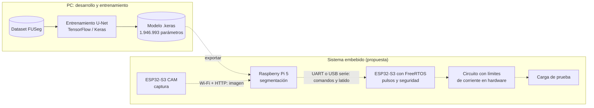

# Nova Luz

Sistema embebido para apoyo al seguimiento de heridas crónicas (úlceras de pie).
Proyecto del curso de Sistemas Embebidos 2026-2.

## Estado actual

| Parte | Estado |
|---|---|
| Segmentación de úlceras con U-Net (TensorFlow/Keras) | Baseline entrenado en PC |
| Captura con cámara (ESP32-S3 CAM) | Planeado |
| Inferencia en Raspberry Pi 5 | Planeado |
| Control con ESP32-S3 y FreeRTOS | Planeado |
| Estimulación eléctrica | Planeado. Solo se probará sobre una carga de prueba, nunca en personas |

## Arquitectura

Las líneas continuas existen hoy. Las punteadas son la propuesta de trabajo, por validar.



## Requisitos

Python 3.12 y Git.

## Instalación

```
git clone --recurse-submodules https://github.com/AlejandroUrregoIdarraga29/pie-diabetico-ia.git
cd pie-diabetico-ia
py -m venv pie_diabetico_env
pie_diabetico_env\Scripts\activate.bat
pip install -r requirements.txt
```

## Uso

Desde la raíz del repositorio:

```
python auditoria_fuseg.py
python entrenar_unet.py
```

`entrenar_unet.py` entrena 20 épocas y en CPU tarda mucho.

## Estructura

- `config.py`: rutas del proyecto, calculadas desde la ubicación del repositorio
- `*.py`: scripts de auditoría de datos y entrenamiento
- `wound-segmentation/`: submódulo con el dataset FUSeg
- `modelos/` y `resultados/`: salidas locales, no se versionan

## Notas

- TensorFlow en Windows nativo solo usa CPU.
- El modelo entrenado no se versiona; pídelo al equipo.